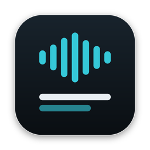
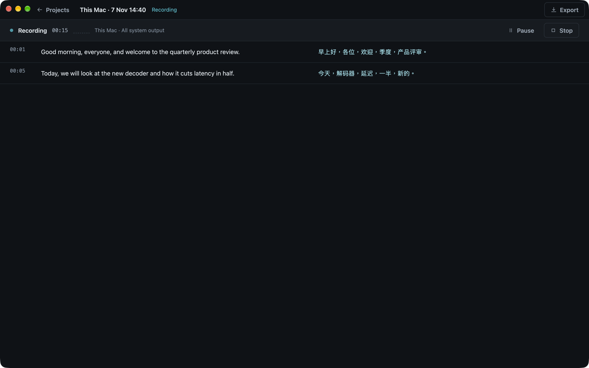
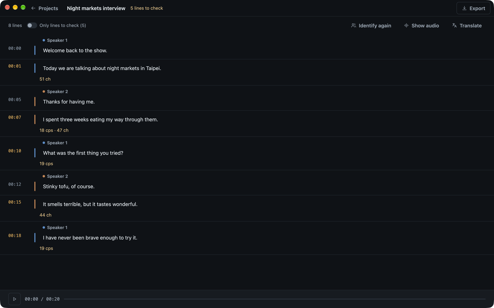

<p align="center">
  
</p>

<h1 align="center">Taurus</h1>

<p align="center">A subtitle workbench for macOS: caption live audio, transcribe videos, tell speakers apart, and translate, all on your own Mac.</p>

<p align="center">
  
</p>

## What it does

- **Live caption.** Captions what you hear as it plays: your Mac's sound and your microphone together (the default, good for both sides of a call), or either one alone. Taurus records the audio into the project, so you can play it back or work on it later. On macOS 15 and later it can also record the screen, either the whole display or just one app's windows, as an `.mp4` kept with the project on the same clock as the captions. Movies are HEVC (H.265), at Small (720p, 15 fps), Standard (1080p, the default) or Full (the display's own resolution). Save a setup you use often (what to listen to, which microphone, what to record and at what quality) as a named profile. The dialog always opens with the choices of your last capture.
- **From a video.** Reads a video's subtitle track, or transcribes its audio when it has none. Long cues are retimed and split.
- **Import subtitles.** Drop in `.srt`, `.vtt`, `.ass` or `.ssa` files.
- **Speaker identification.** Works out who said each line and labels it Speaker 1, Speaker 2 and so on. Click a name to rename that speaker everywhere.
- **Translation, if you want it.** Off by default. Turn it on when you start a capture or a video, or add it to any project later. It works with any OpenAI-compatible endpoint, such as a local Ollama, and follows your glossary.
- **Summary.** A short account of the lines, through the translation endpoint. You choose the language, the model and whether it is a few sentences or a fuller account. It stays with the project.
- **Review.** Each line is checked against reading speed (17 characters per second), line length (42 characters) and the gap to the next line. "Only lines to check" shows just the lines that need work. Click any text to edit it.
- **Playback.** Play the project's audio, click a timestamp to jump to it, and the list follows along. Space plays and pauses.
- **Glossary.** Terms you prefer, keep untranslated, or never want to see. Each one applies to every project or to just one.
- **Export.** SRT, VTT, ASS or plain text. You can include the original, the translation or both, with optional speaker names, line wrapping and merging.

<p align="center">
  
</p>

## Everything runs locally

| Job | Engine | Where it runs |
|---|---|---|
| Speech to text | [Whisper](https://github.com/ggerganov/whisper.cpp) (tiny to large-v3-turbo), using Metal | On this Mac |
| Speech to text | [Qwen3-ASR](https://huggingface.co/Qwen) 0.6B or 1.7B, using ONNX Runtime | On this Mac |
| Speech to text | Qwen3-ASR on your own server (OpenAI-compatible) | Your server |
| Speaker identification | [3D-Speaker CAM++](https://github.com/modelscope/3D-Speaker) (zh/en, 28 MB), using ONNX Runtime | On this Mac |
| Translation | Any OpenAI-compatible chat endpoint, for example Ollama with `qwen3:8b` | Wherever you point it |

Models download from inside the app the first time they're needed. Choose them in **Engines** in the top bar.

## Requirements

- macOS 13 or later. An Apple Silicon Mac is recommended.
- [Rust](https://rustup.rs) 1.85 or later, for the 2024 edition.
- Xcode Command Line Tools, for the ScreenCaptureKit bridge: `xcode-select --install`.
- `ffmpeg`, to read videos: `brew install ffmpeg`.
- For translation, an endpoint such as [Ollama](https://ollama.com): `ollama pull qwen3:8b`.

## Build and run

```sh
cargo run --release
```

To build an app you can put in Applications, use [`cargo-bundle`](https://github.com/burtonageo/cargo-bundle):

```sh
cargo install cargo-bundle
cargo bundle --release
open target/release/bundle/osx/Taurus.app
```

This also writes a disk image, `target/release/bundle/dmg/Taurus.dmg`.

On GitHub, every push and pull request is built and tested (`.github/workflows/ci.yml`). Releases are versioned by tag (`.github/workflows/release.yml`). Push a tag such as `v0.2.0` (`git tag v0.2.0 && git push origin v0.2.0`), or run **Release** from the Actions tab and type `0.2.0`. Either way, the app is built as version 0.2.0 and published on the Releases page as a `.dmg`, a `.zip` and their SHA-256 checksums. Tags with a suffix, like `v0.2.0-beta.1`, are marked as pre-releases. The app is signed ad hoc but not notarised, so on first launch, right-click it and choose **Open**.

The first live caption asks for **Screen & System Audio Recording** permission, which is needed to hear the Mac's sound, or **Microphone** permission. You can manage both in System Settings, under Privacy & Security.

## Getting started

1. Open **Engines** and download a speech model. Whisper `base` is quick for live work; `large-v3-turbo` or Qwen3-ASR 1.7B are more accurate.
2. Click **New** and choose **Live caption**, **From a video** or **Import subtitles**.
3. Optionally turn on **Translate the lines** and choose a language. To translate a project later, use **Translate** in its toolbar.
4. To label speakers, click **Identify speakers** in a project that has audio.
5. Click **Summarize** in a project's toolbar and choose the language, the model and the length. The account is saved with the project.
6. Click **Export** when the lines read well.

## Where your data lives

Everything is stored in `~/Library/Application Support/Taurus`:

| Path | Contents |
|---|---|
| `library.json` | Projects (lines, translations, speakers) and the glossary |
| `settings.json` | Engine choices and the translation endpoint |
| `recordings/<project>.wav` | Audio recorded during live captions (16 kHz mono) |
| `models/` | Downloaded speech and speaker models |

Video projects refer to the original file where it is. Taurus doesn't copy it.

## Development

```sh
cargo test                                         # unit tests
cargo test e2e -- --ignored --test-threads=1       # end-to-end: ffmpeg, Whisper, Qwen, speakers, translation
```

The end-to-end tests use real models and `ffmpeg`, and the speaker test uses macOS `say` voices. Any model that is missing is downloaded the first time.

Debug builds accept environment variables that open the app straight into a given screen, which helps with screenshots:

| Variable | Effect |
|---|---|
| `TAURUS_DATA_DIR=<dir>` | Use another folder for the library, settings and recordings |
| `TAURUS_VIEW=editor\|glossary` | Start in the open project or the glossary |
| `TAURUS_DIALOG=engines\|capture\|export\|translate` | Open a dialog |
| `TAURUS_IMPORT=a.srt,b.vtt` / `TAURUS_EXTRACT=video.mp4` | Import files or pick a video |
| `TAURUS_LIVE=system\|mic` | Start a live caption |
| `TAURUS_PLAY=<ms>` / `TAURUS_SPEAKERS=1` / `TAURUS_TRANSLATE=1` | Play, identify speakers, or translate the open project |
| `TAURUS_MENU=1` | Open the New menu |

### Layout

```
src/
  main.rs         window and app setup
  app.rs          the Workbench state and its actions
  work.rs         background jobs: extraction, translation, live capture, playback, speakers
  shell.rs        top bar, dialogs, selects, toasts
  views/          projects, workspace (editor), live, extract, export, glossary
  engine/         asr (Whisper), qwen (Qwen3-ASR), speaker (CAM++), mt (translation), mel
  capture.rs      ScreenCaptureKit and microphone input
  live.rs         streaming recognition and recording
  player.rs       audio playback
  media.rs        ffmpeg probing and decoding
  subs.rs         SRT, VTT and ASS parsing
  data.rs         projects, checks, glossary rules, export
  store.rs        files on disk
assets/icon/      app icon; regenerate with `python3 assets/icon/make_icon.py`
design/           the original design handoff
```

Built with [gpui](https://www.gpui.rs) and [gpui-component](https://github.com/longbridge/gpui-component).
